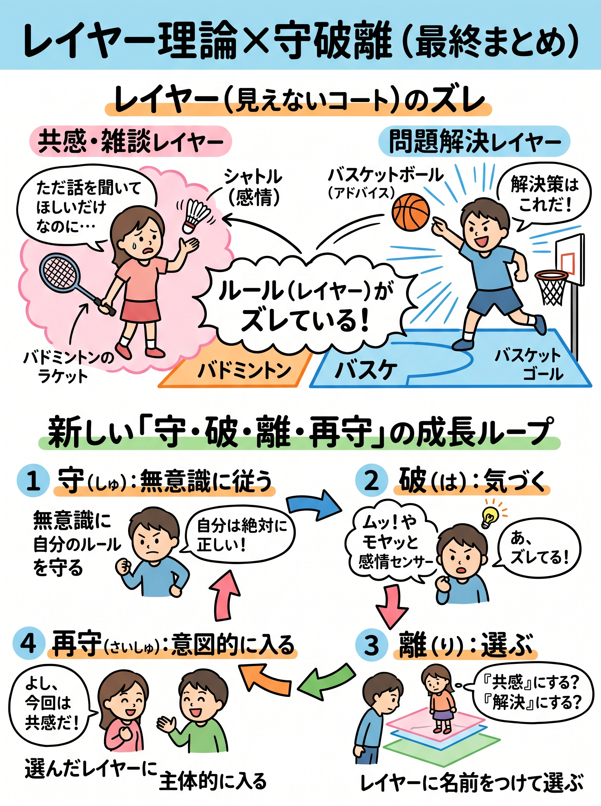

# レイヤー理論解説

### はじめに：なぜ、話が通じないのか？

「良かれと思ってアドバイスしたのに、相手が不機嫌になった」
「やるべきことは分かっているのに、なぜかモヤモヤして動けない」

日常で起きるこうした「イライラ」や「迷い」。私たちはつい、「相手の性格が悪いからだ」「自分の意志が弱いからだ」と、**人や能力の問題**にしてしまいます。

しかし、すべての問題の正体はもっとシンプルです。
それは、「レイヤー（今いる空間のルール）がズレているだけ」なのです。

今回は、複雑な人間関係や自分の感情をスッキリ整理し、迷いなく行動できるようになる思考のOS「レイヤー理論 × 守破離」をわかりやすく解説します。

---

### 1. 世界は「レイヤー」でできている

まず、「レイヤー」とは何か？
一言でいうと、「その場の空気・ルール・役割がセットになった『見えないコート（競技場）』」のことです。

たとえば、同じ体育館の中にいても、「バスケットボールのコート」と「バドミントンのコート」ではルールがまったく違いますよね。
バスケのコートでは「ドリブルしてゴールに投げ込む」のが正解ですが、バドミントンのコートで同じことをしたら試合になりません。

私たちの日常も、これと同じように無数の「レイヤー」が重なってできています。

* **問題解決レイヤー**（ルール：最短で正解を出すことが正義）
* **共感・おしゃべりレイヤー**（ルール：気持ちに寄り添うことが正義）
* **雑談レイヤー**（ルール：オチがなくても楽しく話す）
* **緊急対応レイヤー**（ルール：丁寧さよりスピード最優先）

私たちは普段、無意識のうちにどれかのレイヤーに入って生活しています。

---

### 2. すべての問題は「レイヤーのズレ」で起きる

では、なぜイライラや迷いが起きるのでしょうか？
理由はたった一つ。「違うレイヤー同士でぶつかっているから」です。

わかりやすい3つの具体例を見てみましょう。

#### ケース①：パートナーや同僚とのすれ違い（人間関係のズレ）

* **相手の状況：** 仕事の愚痴を聞いてほしくて話している（＝**共感レイヤー**）
* **あなたの対応：** 「それならこう改善すれば？」と正論を言う（＝**問題解決レイヤー**）
* **結果：** 相手は「そういうことじゃない！」と怒り、あなたは「せっかくアドバイスしたのに！」とイライラする。

これは、**バドミントンのラケットを持った相手に、全力でバスケットボールを投げつけている状態**です。どちらが悪いのでもなく、「入っているコート（レイヤー）」が違うだけなのです。

#### ケース②：休日に休めないモヤモヤ（自分の中のズレ）

* **状況：** ソファでスマホを見ているが、「あれもやらなきゃ…」と罪悪感がある。
* **原因：** 「全力で休むレイヤー」と「タスクをこなすレイヤー」の**境界線（すき間）で立ち往生している**状態。
* **結果：** 休まらないし、仕事も進まない。つまり「迷い＝どのレイヤーに入るか決まっていない状態」なのです。

---

### 3. 進化版「守・破・離・再守」でレイヤーを乗りこなす

では、この「ズレ」をどうやって直せばいいのでしょうか？
ここで使えるのが、武道や芸事の成長モデルとして有名な「守破離（しゅはり）」に、もう一歩を加えた**4段階のサイクル**です。

1. **守（しゅ）：レイヤーに無意識に従う:** いつもの自動運転モード.
何も疑わず、今の自分のルール（レイヤー）を絶対の正解だと思い込んで行動している状態です。「仕事なんだから効率がすべてでしょ！」と無意識に信じている状態です。

2. **破（は）：「ムッ」としてズレに気づく:** 感情が教えてくれるアラーム.
相手と話が噛み合わなかったり、物事がうまくいかず**「ムッ」としたり「モヤッ」としたりする瞬間**です。多くの人はここで「怒り」に任せて相手を攻撃し、再び自分の『守』に閉じこもってしまいます。しかし実は、**「ムッ」は「今、レイヤーがズレてるよ！」と教えてくれる最高のセンサー（破）**なのです。

3. **離（り）：一歩引いて、レイヤーに名前をつける:** 冷静な選択モード.
「ムッ」としたら一呼吸置き、状況を上から眺めます。そして今の状況に**名前（ラベル）**をつけます。
「あ、自分は今『効率重視レイヤー』にいたけど、相手は『安心したいレイヤー』にいるな」と名前をつけた瞬間、心はスッと冷静になり、どのレイヤーを選ぶか自由になります。

4. **再守（さいしゅ）：選んだレイヤーに意図的に入り直す:** 迷いゼロの行動モード.
ここが一番重要です。冷静になって終わりではなく、**「よし、今は10分間だけ『共感レイヤー』に入ろう！」と自分で決めて、そのルールに全力で乗っかります。** 自分で選んで入り直す（再守）からこそ、行動に一切の迷いがなくなります。

---

### 4. 図解：感情とレイヤーの関係

日常で感情が動いたとき、あなたの頭の中ではこんな分岐が起きています。

| 心の状態 | 守破離の段階 | 起きていること |
| --- | --- | --- |
| **「ムッ」「モヤッ」** | **破（気づき）** | レイヤーのズレを検知したサイン！（チャンス） |
| **「イライラ・怒り」** | **守（固定）** | ズレを無視して「自分のレイヤーが絶対正しい！」と固執している状態 |
| **「冷静・俯瞰」** | **離（自由）** | お互いのレイヤーに名前をつけ、「どれに入ろうかな？」と選べる状態 |
| **「スッキリ・集中」** | **再守（没入）** | 自分で選んだレイヤーに入り直し、迷いなく動いている状態 |

---

### 5. 今日から使える！魔法の「名前つけ」ワーク

この理論の一番のコツは、「レイヤーに名前をつけると、思い通りに操作できる」ということです。

スマホのアプリを切り替えるように、自分なりの「レイヤー名」を作ってみましょう。

* 子どもがぐずってイライラしたとき：
* 「おっと、今は『時間厳守レイヤー』で焦っていたぞ。15分だけ『甘え受け止めレイヤー』に切り替えよう」

* 仕事で完璧を求めすぎて手が止まったとき：
* 「今は『100点を目指す職人レイヤー』に入っているな。まずは『30点でいいから爆速で出すレイヤー』に入り直そう」

---

### まとめ：最強の合言葉

人生のあらゆるトラブルや迷いにぶつかったら、心の中でこの呪文を唱えてみてください。

> **「ズレに気づき、名前をつけ、選び、そこに入る」**
> （もっと短く言うなら：**「ズレたら、名前つけて、レイヤー変える」**）

相手を変える必要も、自分の性格を責める必要もありません。
ただ「今いるレイヤー」に名前をつけ、一番心地よく動けるレイヤーを選び直して、そこに入り直すだけ。それだけで、あなたの毎日は驚くほどスムーズに回り始めます。
